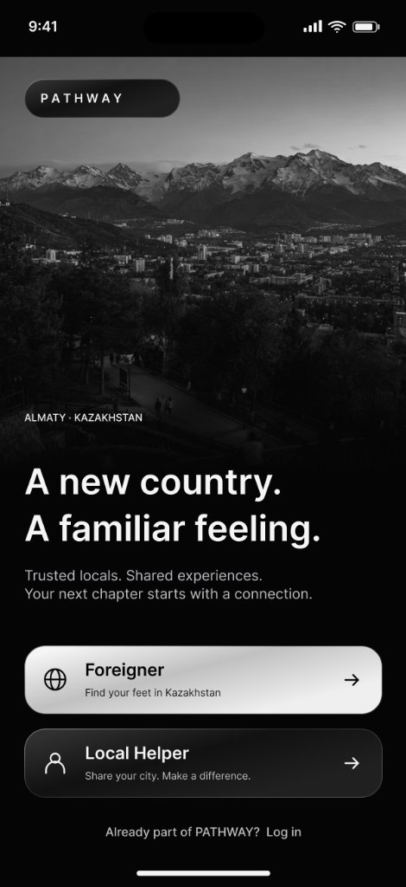
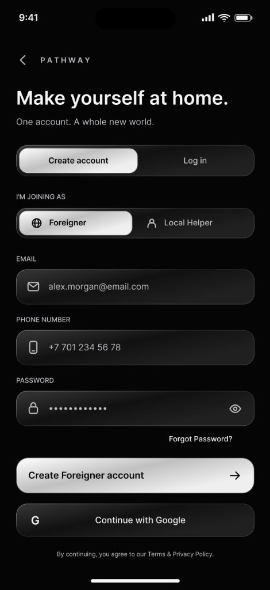
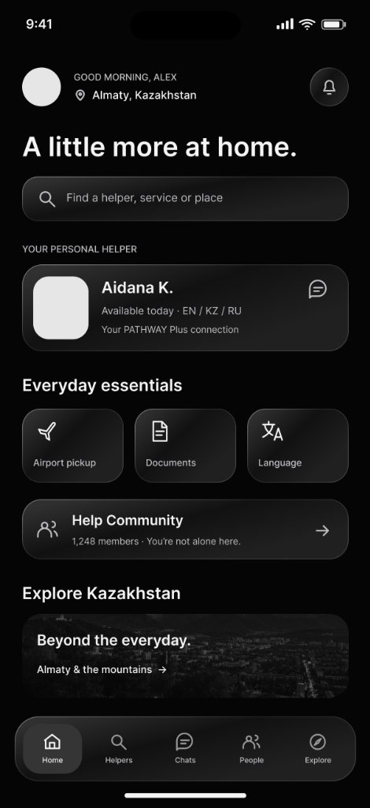
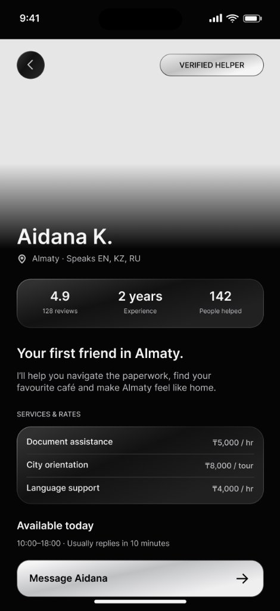
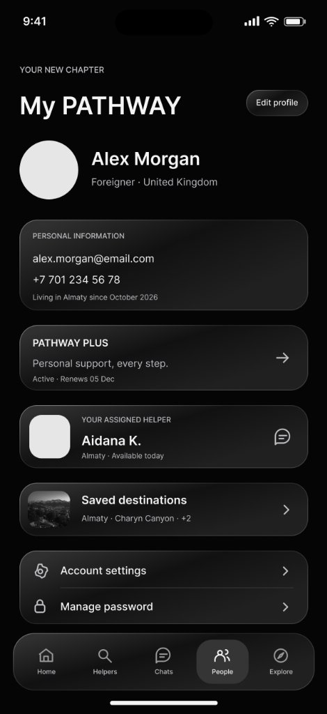
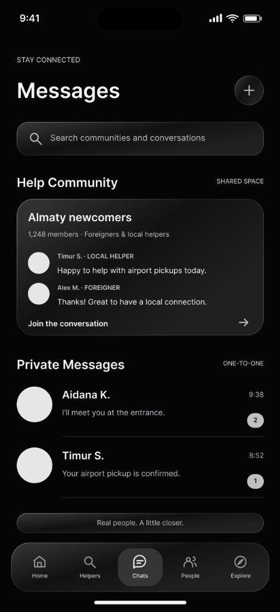
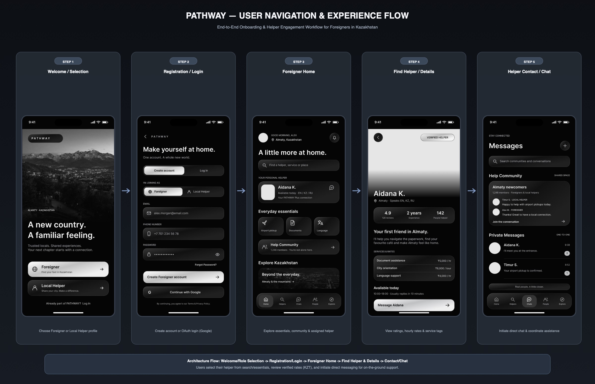

# PATHWAY — App Concept & Screen Flow

> **SWYNEX Technologies App Development Internship — Task 1**  
> **Project Name:** PATHWAY  
> **Repository:** `SWYNEX-App-Concept-and-Screen-Flow`  
> **Status:** Completed  

---

## 1. Project Overview

**PATHWAY** is a dedicated mobile platform engineered to assist foreign nationals, expatriates, international students, and newcomers in Kazakhstan to adapt smoothly to daily life. Relocating to a new country presents steep linguistic, legal, logistical, and cultural barriers. 

PATHWAY bridges this gap by creating a human-centered, trusted peer-to-peer ecosystem that connects newcomers directly with verified local bilingual helpers. Through PATHWAY, foreigners can arrange airport pickups, navigate local bureaucracy and document registration, obtain language interpretation, and explore local culture with local guidance.

```
       Foreigner / Newcomer                            Local Helper
  ┌─────────────────────────────┐               ┌─────────────────────────────┐
  │ • Language barrier          │               │ • Multilingual local        │
  │ • Bureaucracy navigation    │ ◄───PATHWAY──►│ • Offers custom services    │
  │ • Neighborhood orientation  │    Platform   │ • Flexible hourly earnings  │
  │ • Community integration     │               │ • Verified reputation badge │
  └─────────────────────────────┘               └─────────────────────────────┘
```

---

## 2. Problem Statement

Relocating to Kazakhstan offers incredible opportunities, but incoming foreigners face several acute friction points:

1. **Linguistic Isolation:** Official paperwork, street signage, healthcare, and tenancy contracts are predominantly in Kazakh and Russian. Non-speakers often experience severe communication bottlenecks.
2. **Complex Bureaucracy:** Settling in requires registering at Public Service Centers (ЦОН / PSC), securing an Individual Identification Number (IIN), opening local bank accounts (e.g., Kaspi), and registering SIM cards. Navigating these without local guidance can be overwhelming and error-prone.
3. **Absence of a Vetted Assistance Network:** Foreigners often resort to ad-hoc social media groups or informal channels where service quality is erratic, rates are non-standardized, and trust is difficult to verify.
4. **Cultural Adaptation Friction:** Practical daily logistics—such as navigating transport, grocery ordering, and understanding local etiquette—require contextual, on-the-ground knowledge that generic travel guidebooks cannot provide.

---

## 3. Proposed Solution

**PATHWAY** addresses these challenges by transforming local knowledge into accessible, verified on-demand support:

- **Dual-Sided Onboarding:** Tailored role selection during registration for **Foreigners** and **Local Helpers**, optimizing the UX for each persona.
- **Verified Local Helpers:** A directory of vetted bilingual/multilingual locals who provide document assistance, city tours, airport pickups, and translation.
- **Transparent Rates in Tenge (₸):** Transparent hourly rates and fixed-price task packages prevent price gouging and ensure predictability.
- **Structured Communication:** Integrated one-to-one messaging and community forums provide safe channels for coordinating logistics before meeting.
- **Personalized Safety & Tiering:** Features like **PATHWAY Plus** offer dedicated ongoing support and assigned helpers for extended stays.

---

## 4. Target Audience

### Primary Persona A: The International Newcomer (Foreigner)
- **Profile:** Expatriate professionals, digital nomads, international university students, and tourists arriving in cities such as Almaty and Astana.
- **Core Needs:** 
  - Rapid settlement (IIN acquisition, SIM activation, bank account setup).
  - Trusted English-speaking local contacts.
  - Transparent pricing for orientation services.
  - Safe, peer-reviewed assistance.

### Primary Persona B: The Local Helper
- **Profile:** Multilingual university students, young professionals, and certified guides living in Kazakhstan (proficient in Kazakh, Russian, and English).
- **Core Needs:**
  - Flexible part-time earning opportunities.
  - A secure platform to showcase cultural knowledge and language skills.
  - Built-in verification badges to build credibility with international visitors.
  - Structured booking and messaging tools.

---

## 5. Main Features

### Implemented Mockup Scope (Task 1 Deliverable)
- **Role-Based Welcome & Onboarding:** Dynamic entry screen allowing users to identify as either a Foreigner or a Local Helper.
- **Multi-Method Registration:** Account creation supporting email, phone verification, and third-party OAuth (Google).
- **Foreigner Home Dashboard:** Central hub highlighting the user's assigned personal helper, quick-access everyday essential services, community member counts, and city exploration teasers.
- **Verified Helper Profile & Rate Card:** Comprehensive helper profile displaying verification badges, star rating, experience level, total people assisted, languages spoken, hourly rates per service (₸), and direct messaging triggers.
- **My PATHWAY Account Management:** Profile view displaying membership status (PATHWAY Plus), assigned helper shortcuts, saved travel destinations, and security settings.
- **Messages & Community Hub:** Dual-tier communication interface featuring community channels ("Almaty newcomers") alongside private one-to-one threads.

### Proposed Architecture & Future Functional Scope
- **Interactive Helper Directory & Geo-Search:** Filter helpers by language, specific city district (Medeu, Bostandyk, etc.), and hourly rate brackets.
- **In-App Escrow Payments:** Integration with local payment rails (Kaspi Pay, Halyk) and international credit cards (Visa/Mastercard) with milestone release upon task completion.
- **In-App SOS & Emergency Translation:** Instant voice-to-text phrasebook and emergency embassy/police hotlines.

---

## 6. Primary Screens

Below are the primary user interface screens designed for PATHWAY:

| Screen Name | File Path | Key Purpose |
|:---|:---|:---|
| **01. Welcome & Role Selection** | `screens/01-Welcome.png` | Landing screen setting the visual tone with city imagery; prompts user role selection. |
| **02. Registration & Auth** | `screens/02-Registration.png` | Role-aware signup form capturing credentials, phone, and Google OAuth. |
| **03. Foreigner Home Dashboard** | `screens/03-Home.png` | Overview displaying search, assigned helper card, everyday essentials, and community entry. |
| **04. Helper Profile & Details** | `screens/04-Helper-Details.png` | Shows ratings, experience, languages spoken, verified badge, and service rate cards in ₸. |
| **05. My PATHWAY (Profile Hub)** | `screens/05-Profile-My-Pathway.png` | Personal user hub displaying active subscription, assigned helper, saved places, and settings. |
| **06. Messages & Community Hub** | `screens/06-Messages-Chats.png` | Communication suite containing community broadcast spaces and direct 1-on-1 chats. |

> **Screen Architecture Note:** In this release, `screens/04-Helper-Details.png` represents both the dedicated Helper Profile detail view and the destination target for the directory browse flow. For full project structure consistency, `screens/05-Helper-Details.png` is retained as an alias to `04-Helper-Details.png`.

---

### Detailed Screen Showcase

#### 1. Welcome & Role Selection
The welcome screen introduces the brand promise: *"A new country. A familiar feeling."* It contextualizes the experience with a scenic view of Almaty and the Tian Shan mountains, directing newcomers and local helpers into customized flows.

<p align="center">
  
</p>

---

#### 2. Registration & Authentication
Clean, distraction-free authentication supporting segmented role toggling (**Foreigner** vs. **Local Helper**), direct credential submission, and single-tap Google authentication.

<p align="center">
  
</p>

---

#### 3. Foreigner Home Dashboard
The home screen organizes essential newcomer services into clear tactile touchpoints:
- **Search Header:** Global search for helpers, services, or locations.
- **Your Personal Helper Card:** Instant card showing current availability and language proficiencies (EN / KZ / RU).
- **Everyday Essentials:** Quick shortcuts for *Airport pickup*, *Documents / Registration*, and *Language interpretation*.
- **Help Community Banner:** Direct gateway to peer support groups.
- **Explore Kazakhstan:** Curated recommendations (Almaty & the mountains).

<p align="center">
  
</p>

---

#### 4. Helper Profile & Service Details
Transparent helper overview displaying verified trust credentials:
- **Trust Metrics:** 4.9 rating (128 reviews), 2 years experience, 142 people helped.
- **Bio & Philosophy:** *"Your first friend in Almaty."*
- **Transparent Service Rate Card:**
  - Document assistance: **₸5,000 / hr**
  - City orientation: **₸8,000 / tour**
  - Language support: **₸4,000 / hr**
- **Operating Hours:** Real-time availability status and typical response window (10 minutes).
- **Primary CTA:** Sticky **Message Aidana** button.

<p align="center">
  
</p>

---

#### 5. My PATHWAY (Profile & Management)
Personal space managing the newcomer's ongoing stay:
- **User Demographics:** Name, origin country (e.g., United Kingdom), arrival date.
- **Membership Status:** Active PATHWAY Plus subscription details.
- **Assigned Helper Shortcut:** One-tap access to chat with the assigned helper.
- **Saved Destinations:** Bookmarked sights and cultural attractions.

<p align="center">
  
</p>

---

#### 6. Messages & Community Hub
Integrated messaging experience providing two levels of social contact:
- **Help Community (Shared Space):** General chat channels where newcomers ask questions and local helpers offer immediate assistance.
- **Private Messages (One-to-One):** Direct, encrypted conversation threads with helpers to coordinate pickups, document appointments, and payments.

<p align="center">
  
</p>

---

## 7. Navigation Flow

### End-to-End User Journey

```
┌───────────────────────────────────────┐
│     01. Welcome & Role Selection      │
│   (Select 'Foreigner' / 'Helper')     │
└───────────────────┬───────────────────┘
                    │
                    ▼
┌───────────────────────────────────────┐
│       02. Registration / Login        │
│    (Email, Phone, Google OAuth)       │
└───────────────────┬───────────────────┘
                    │
                    ▼
┌───────────────────────────────────────┐
│       03. Foreigner Home Hub          │
│   (Search, Essentials, Helper Card)   │
└─────────┬───────────────────┬─────────┘
          │                   │
  (Select Helper / Search)    │ (Bottom Nav: Chats / People)
          │                   ▼
          ▼        ┌────────────────────────────────────┐
┌──────────────────┴────────────┐  │  05. Profile / 06. Messages Hub    │
│   04. Helper Details Screen   │  └────────────────────────────────────┘
│  (Rates, Reviews, Languages)  │
└───────────────┬───────────────┘
                │
         (Message CTA)
                ▼
┌───────────────────────────────┐
│    06. Direct Message Chat    │
│  (Coordinate Time & Service)  │
└───────────────────────────────┘
```

### Visual Navigation Flow Diagram

The complete high-resolution visual navigation flow has been rendered and embedded below:



---

## 8. UI Design Concept

- **Aesthetic Direction:** Modern Dark Minimalist / OLED Dark Mode.
- **Color Palette:**
  - **Dominant Base:** Deep obsidian blacks (`#0B0D10` / `#000000`) for visual comfort and high contrast.
  - **Surface Elevation:** Subtle frosted glass cards (`rgba(255, 255, 255, 0.08)`) with refined hairline borders (`rgba(255, 255, 255, 0.14)`).
  - **Accents & CTAs:** High-contrast luminous white gradients with crisp black typography for primary buttons, creating immediate visual hierarchy.
  - **Typography:** Modern clean sans-serif typography (SF Pro / Inter) optimized for legibility across variable screen sizes.
- **Iconography & Micro-interactions:** Consistent stroke-based icons paired with rounded badge counters and localized status indicators.

---

## 9. Future Improvements

1. **Integrated In-App Booking & Calendar Sync:** Allow users to schedule sessions directly based on helper availability.
2. **Escrow Payment Integration:** Secure in-app payments with automatic currency conversion and escrow protection.
3. **Official Public Service Center (PSC) Integration:** Guided step-by-step digital checklists for IIN, residency permits, and bank registration.
4. **Offline Emergency Mode:** Localized phrase cards and emergency hotline coordinates accessible without an active cellular data connection.
5. **Helper Verification Tiering:** Tiered verification levels (Government ID verification, background check, language proficiency interview).

---

## 10. Repository Structure

```text
SWYNEX-App-Concept-and-Screen-Flow/
│
├── README.md                          # Comprehensive project documentation
├── screen-flow.png                    # High-resolution navigation flow diagram
└── screens/                           # High-fidelity UI mockup screens
    ├── 01-Welcome.png                 # Welcome & Role Selection
    ├── 02-Registration.png            # Account Registration & OAuth
    ├── 03-Home.png                    # Foreigner Home Dashboard
    ├── 04-Helper-Details.png          # Helper Profile, Rates & Reviews
    ├── 05-Helper-Details.png          # Helper Details alias for structure compliance
    ├── 05-Profile-My-Pathway.png      # User Profile & Membership Hub
    └── 06-Messages-Chats.png          # Community & Direct Chat Interface
```

---

*Prepared by Karina B. for the SWYNEX Technologies App Development Internship — Task 1 (App Concept and Screen Flow).*
